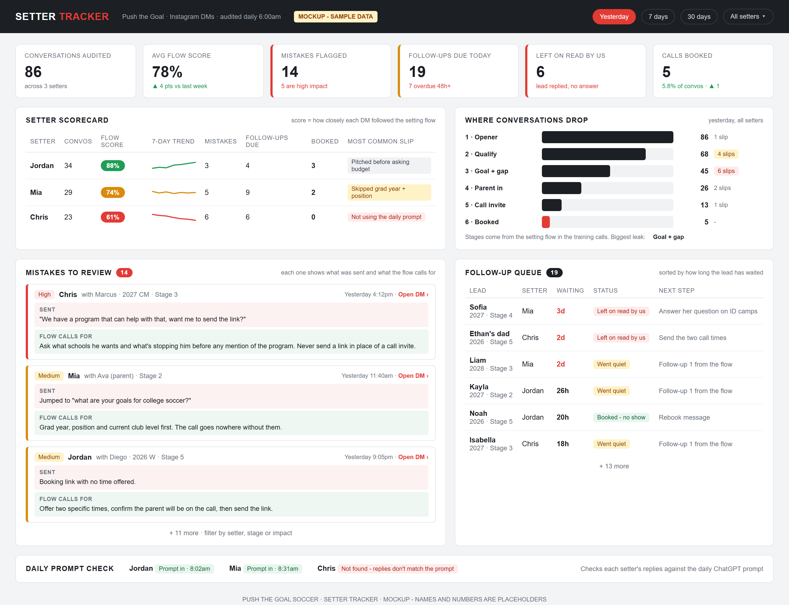

# Setter System Tracker Dashboard

Handoff for whoever on the Push the Goal team builds this. It covers everything decided so far,
the rules, and where Izi left off. Read all of it before writing any code.

Izi approved this layout on 2026-10-27 ("Layout looks right"). The mockup source is
`mockup/dashboard-mockup.html`. **Every name, number and flow stage in it is a placeholder.** The
real stages come from the playbook (step 1 below).

## The goal, in Izi's words

> "The ultimate setter system tracker ... an AI agent ... that is going to go into DM
> conversations every single day to audit them and to make sure that the flow is exactly what it
> needs to be."

In practice: every morning Izi opens one page and sees how each setter did yesterday, where they
went off the setting flow, and which leads are waiting on a reply. He shouldn't have to read a
single DM to find out. It has to be clear, short and easy to read, and it has to make mistakes
easy to spot.

## Where it stands (2026-10-27)

| Item | Status |
|---|---|
| Project overview | Done - this file |
| Dashboard mockup | Done and approved - `mockup/` |
| Playbook (the standard every DM is scored against) | **Not started.** Izi asked to start it, then paused to hand the build to the team. **No training material has been shared yet** |
| GHL read access to conversations | **Not set up.** See "Data source" |
| Daily audit, follow-up tracking, live dashboard | Not started |

**Pick up at step 0 in "Build order".**

## How it works

1. **Playbook (built once, then kept up to date).** Turn Izi's setting training into one written
   standard:
   - the stages of a conversation
   - what has to happen at each stage
   - the mistakes that break it, each with an impact level (high / medium / low)
   - the follow-up rules (when, and what to send)

   Every score depends on this file, so it has to come from Izi's own material and not from
   generic sales advice. Store it as `playbook.md` in this folder and have Izi sign it off.
2. **Daily pull.** Read the last 24 hours of Instagram DM conversations from GHL. Read only.
3. **Daily audit.** Claude reads each conversation against the playbook and records:
   - which stage it reached
   - a flow score (0-100%)
   - each mistake, with the line that was sent, what the flow calls for, the impact level, and
     a link to the DM
   - whether the setter's replies follow that day's ChatGPT prompt
4. **Follow-up tracking.** Every open conversation gets one status:
   - **Left on read by us** - the lead's message was the last one and has gone unanswered. This
     is the most urgent status.
   - **Went quiet** - our message was the last one and the lead has stopped replying.
   - **Booked - no show** - taken from GHL's "SALES TRACKING" pipeline (Call Booked, No Show,
     Sale Pending).

   Each one gets its next step from the playbook's follow-up rules.
5. **Dashboard.** The six parts in the mockup, refreshed every morning:

   | Section | Shows |
   |---|---|
   | Top numbers | Conversations audited, average flow score, mistakes flagged (how many high impact), follow-ups due (how many overdue 48h+), left on read by us, calls booked |
   | Setter scorecard | One row per setter: conversations, flow score, 7-day trend, mistakes, follow-ups due, calls booked, most common slip |
   | Where conversations drop | How many conversations reached each playbook stage, and how many slips happened at each one |
   | Mistakes to review | Each mistake as a card: setter, lead, stage, impact, "Sent" next to "Flow calls for", and an Open DM link |
   | Follow-up queue | Leads sorted by how long they've waited: setter, status, next step |
   | Daily prompt check | For each setter, whether their replies match today's ChatGPT prompt |

   Filters: Yesterday / 7 days / 30 days, and by setter.

## Data source: GHL

- Push the Goal's Instagram DMs already reach GHL. In Settings -> Integrations -> Instagram,
  "Push The Goal (via Facebook page)" and "Izi Chinchay (via Facebook page)" have messaging on.
  @izimurray_ connected directly has messaging **off**, so its DMs may not be in GHL. See the
  questions below.
- The Push the Goal sub-account is location `9dGHqncMtM4QA0Ir5fGr`. Its pipelines include
  "DM INSTAGRAM", "INSTAGRAM DMS" and "SALES TRACKING".
- The existing key, Private Integration **"Claude Content System"**, can read contacts,
  calendars, opportunities, workflows and tags. **It cannot read conversations or messages.**
  Either add the read-only conversation and message scopes to it, or (better for a teammate)
  create your own Private Integration named `Claude - Setter Tracker` with read-only scopes:
  conversations, conversation messages, contacts, opportunities, calendars.
- Context on the GHL setup: `content-plan-dashboard/SETUP.md` and
  `content-plan-dashboard/HANDOFF.md`.

## Rules - non-negotiable

1. **Read only. The tracker never sends, replies to, edits or deletes a DM.** It reports
   mistakes. It doesn't fix them in the conversation.
2. **Never edit anything that already exists in GHL** - workflows, automations, tags, pipelines,
   settings or messages. Only create new things named `Claude -` or `TEST -`. Report problems in
   existing setups to Izi and don't fix them.
3. **Keys and tokens never go in git, docs or chat.** Keep them in gitignored files, for example
   `setter-system-tracker-dashboard/.ghl-token`. Add that path to `.gitignore` before you create
   the file.
4. **Score against the playbook only.** Don't invent rules, stages or "best practice". If the
   playbook doesn't cover something, flag it as a question for Izi rather than as a mistake.
5. **Leads are mostly high school athletes (minors) and their parents.** Keep DM content to what
   the dashboard needs. Don't store full transcripts anywhere public, don't put health or
   personal details into summaries, and keep the dashboard private to the team.
6. **No prices** on the dashboard.
7. **Wording on the dashboard follows Izi's voice:** direct and specific, but framed as the next
   step and not as blame (see the warmth correction in `CLAUDE.md`). Use spaced hyphens, never
   em-dashes. Write "message", not "text". Say "athlete", never "child".

## Build order

| # | Step | Done when |
|---|---|---|
| 0 | **Collect the inputs** (list below) from Izi | Everything in "What Izi needs to provide" is in hand |
| 1 | **Write the playbook** from the Fathom training calls, the setting-flow docs and the ChatGPT prompt | Izi has signed off `playbook.md` |
| 2 | **GHL conversation access** with read-only scopes | One day of DMs pulled successfully |
| 3 | **Test audit of one real day.** Score it, then Izi grades a sample of 10-15 conversations by hand | The AI's scores agree with Izi's. Adjust the playbook and prompt until they do |
| 4 | **Daily automatic run** (scheduled job, early morning) writing results to a store | It has run unattended for 3 days in a row |
| 5 | **Live dashboard** built from the approved mockup, reading that store | Izi uses it for a week and it matches what he sees in the DMs |

Step 3 comes before the dashboard on purpose. If the grading is wrong, the dashboard is wrong.

## What Izi needs to provide

- **Training calls:** the Fathom calls where he teaches the setting flow (titles or dates help).
  When searching Fathom, filter by date window only and not by recorder. Titles are
  inconsistent.
- **The written setting flow,** plus any scripts or SOPs.
- **The daily ChatGPT prompt** the setters use. Does it change every day? Where does it live?
  How does a setter "put it in"?
- **The setters:** their names, and which Instagram account each one works from.
- **Which DMs to audit:** @pushthegoalsoccer only, or @izimurray_ too.

## Open decisions (decide in step 0, not now)

- **Where the dashboard is hosted** and who can see it. It holds conversations with minors, so
  it has to be private to the team.
- **Whether setters see their own scorecard,** or it's for Izi only.
- **How a DM is tied to a setter** if several setters share one Instagram account. GHL's
  "assigned user" on the conversation is the likely answer. Check it in step 2.
